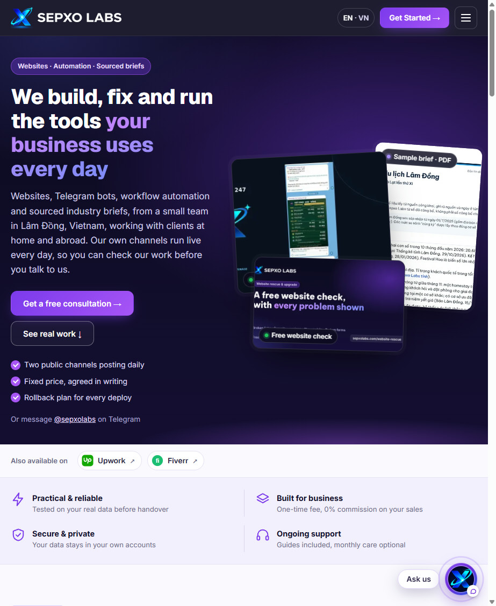
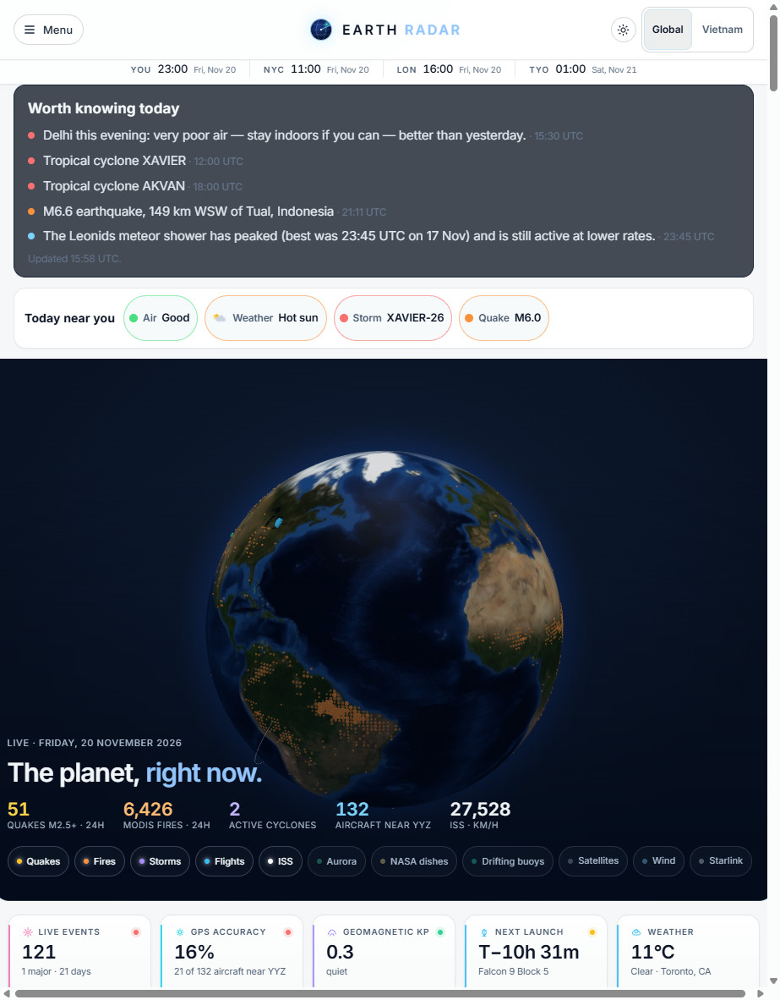

# Phan Tung · Sepxo Labs

### Founder, Sepxo Labs · Business Software · Live Market Boards · Workflow Automation · QA

I run [Sepxo Labs](https://sepxolabs.com) from Đà Lạt, Vietnam — practical business software, automation tools, and live data boards. One-time-purchase Telegram and inbox tools, freelance bot repair on Fiverr and Upwork, and market boards people open every morning.

## Live products

- **[Sepxo Labs](https://sepxolabs.com)** — Telegram and inbox automation tools, buy once, yours to keep. Plus freelance setup and repair for Python Telegram bots.

- **[Earth Radar](https://earthradar.live)** — the planet, live: earthquakes, rocket launches, ISS tracking, space weather, and satellite imagery. Vietnamese edition at [earthradar.live/vn](https://earthradar.live/vn).

- **Wall Street Radar** — US markets by the numbers: live tape, earnings, macro shocks, and a 50-stock board. Cloudflare deployment in progress.
- **Industry boards** — operations and market boards for Đà Lạt flowers, hotels, and commodities (coffee, durian, pangasius), built as working pilots with real operators.

## Services and skills

| Focus | Example deliverables |
| --- | --- |
| Business web applications | Responsive dashboards, forms, data views and workflow prototypes |
| Live data boards | Market, operations and monitoring boards with real sources and update times |
| Telegram & inbox automation | Bots, inbox tools, setup and repair |
| JavaScript & TypeScript | Frontend business logic, validations and integration-ready structure |
| QA & release quality | Reproducible tests, defect notes, test evidence and documented limitations |
| Practical automation | Workflow mapping, repeatable steps, technical handoff and API planning |
| Content clarity | Website UX/copy audits and clear service messaging |

**How I work:** defined scope → working prototype → reproducible QA → usable handoff.

[**View the Upwork portfolio**](https://www.upwork.com/freelancers/~0126fd80a807db2286)

---

*Sepxo Labs · [sepxolabs.com](https://sepxolabs.com) — Original private repositories remain private.*
